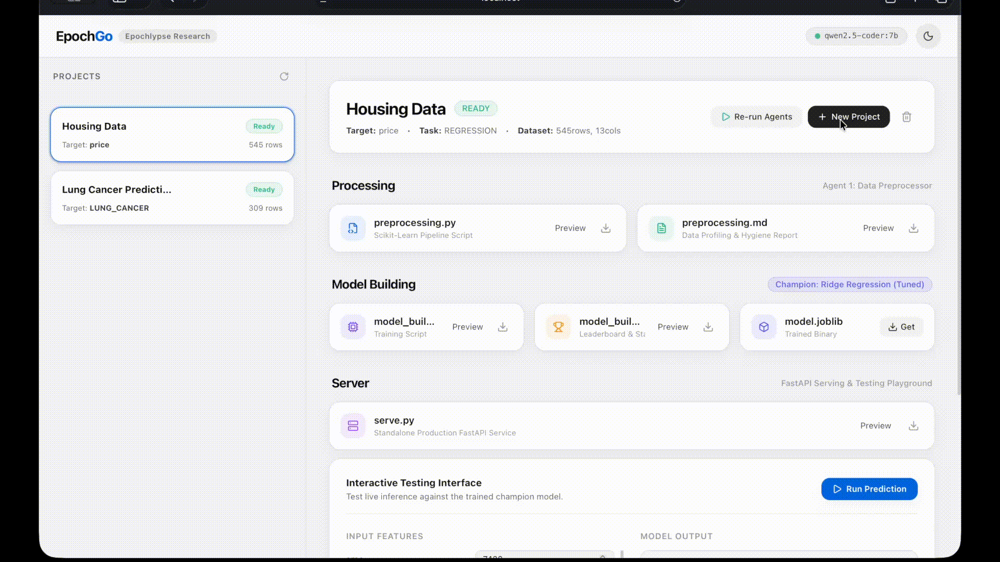
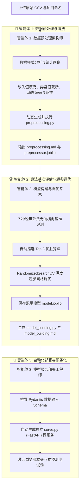

<div align="center">

# ⚡ EpochGo

**自主、本地优先的多智能体自动化机器学习 (AutoML) 平台**  
*由 [Epochlypse Research](https://epochlypse.com/) 开发 &bull; 基于 CrewAI、Ollama 以及 Scikit-Learn / XGBoost / LightGBM / CatBoost*

[](https://www.docker.com/)
[](https://crewai.com)
[](https://ollama.ai)
[](https://fastapi.tiangolo.com)
[](https://github.com/AryanDinakaran/EpochGo/releases)
[](LICENSE)

*零 API 密钥。零云端算力账单。100% 运行在本地设备，彻底保护数据隐私。*

<p align="center">
  <a href="README.md">English</a> | <b>简体中文</b>
</p>

<br/>



</div>

---

## 🌟 项目概述

**EpochGo** 是由 **Epochlypse Research** 开发的开源、本地优先（Local-First）AutoML 平台。只需 `git clone` 代码仓库并通过 Docker 运行，即可在浏览器中访问本地控制面板 (`http://localhost:8000`)。你可以自由创建项目、上传原始 CSV 数据集，并交由 **3 个自主协作的 AI 智能体团队** 全权负责数据科学研发全流程：

1. 🧹 **智能体 1: 数据预处理与特征架构师 (PreprocessorAgent)**
   - 自动检测数据模式、缺失值处理、基于 IQR 准则截断异常值、分类变量动态编码、特征缩放以及高维多重共线性处理 (PCA)。
   - 自动生成并执行独立的 Scikit-Learn 处理脚本 (`preprocessing.py`)。
   - 生成详尽的清洗前后分布对比报告 (`preprocessing.md`)。
   - 保存序列化预处理器对象 (`preprocessor.joblib`) 与清洗后的数据集 (`cleaned_data.csv`)。

2. 🏆 **智能体 2: 机器学习基准评估与超参调优专家 (ModelTrainerAgent)**
   - 在无超参数偏置的条件下，横向评估 **7 种经典机器学习算法**：
     - **分类任务**: XGBoost, LightGBM, CatBoost, Random Forest, Extra Trees, Gradient Boosting, Logistic Regression。
     - **回归任务**: XGBoost, LightGBM, CatBoost, Random Forest, Extra Trees, Gradient Boosting, Ridge Regression。
   - 评估基准 Accuracy / F1 / R² / RMSE 指标并自动筛选出 **前 3 名最佳候选模型**。
   - 运行高效的超参数搜索优化 (`RandomizedSearchCV`)。
   - 生成可复现的模型训练脚本 (`model_building.py`) 与全量 Markdown 分析报告 (`model_building.md`)。
   - 将冠军模型序列化保存为 `model.joblib`。

3. 🚀 **智能体 3: MLOps 与模型服务工程师 (ServingAgent)**
   - 自动生成生产就绪的独立 FastAPI 微服务脚本 (`serve.py`)，并附带与数据集 Schema 严格匹配的 Pydantic 数据类型校验。
   - 启用交互式浏览器端 **Inference Playground (预测测试场)**，实时测试模型预测结果与置信概率。
   - 自动生成开箱即用的 `curl` 命令和 Python API 调用代码片段。

---

## ⚡ What's New in v1.1.0 (企业级生产加固)

基于社区高级机器学习专家的同行评审和实际脏数据的压力测试：

* 🛡️ **自动主键与无用 ID 剔除**: 自动识别非预测性主键、UUID 以及行序号 (`uniqueness_ratio > 0.95` 或 ID 命名 + 唯一性 > 0.80)，并在流水线拟合前自动剔除，防止梯度提升树拟合并记住随机哈希噪声。
* 🎯 **折内目标编码 (`TargetEncoder`)**: 针对高基数类别特征 ($20 < N_{unique} \le 500$)，自动使用 Scikit-Learn 原生 5 折交叉验证的目标编码器 (`cv=5, smooth='auto'`)，严格杜绝验证集目标泄露（Target Leakage）。
* 💾 **彻底消除 4 万类别导致的内存溢出 (OOM)**: 不再生成数万列极度消耗内存的稀疏矩阵，而是将高基数类别压缩为单列连续浮点向量，**内存占用骤降 >99.9%**，确保在 16GB 内存的个人电脑上稳定运行数十万行数据集。
* 🔗 **稳健的特征名动态解析**: 采用原生 `get_feature_names_out()` 支持复杂 `ColumnTransformer`，确保下游推理脚本 (`serve.py`) 能够稳定反序列化并正确响应请求。

---

## 🚀 快速上手 (单命令运行)

### 环境要求

- 已安装 Docker 与 Docker Compose。
- 建议配置 16 GB 内存（Apple Silicon M 系列 Mac，或配备 16GB 内存的 Windows / Linux 电脑）。

### 1. 克隆代码并启动

```bash
git clone https://github.com/AryanDinakaran/EpochGo.git
cd EpochGo
docker compose up --build
```

### 2. 打开浏览器访问

在浏览器中导航至：

```
http://localhost:8000
```

搞定！EpochGo 会自动连接本地 Ollama 服务，确认代码生成模型已加载，并拉起 Web 可视化控制台。

---

## 💻 推荐本地模型与硬件基准

| 指标                      | 目标规格                                                                               |
| :------------------------ | :------------------------------------------------------------------------------------- |
| **推荐模型**              | **`qwen2.5-coder:7b`**                                                                 |
| **选择原因**              | 顶级的 Python 代码合成能力、精通 Scikit-Learn 规范、并且具备极高精度的 Markdown 报告输出能力。 |
| **显存 / 内存占用**       | 约 4.7 GB RAM                                                                          |
| **推荐运行硬件**          | 16 GB 统一内存 Mac (Apple Silicon M 系列) 或主流 PC 电脑                                |
| **可用算力余量**          | 预留 >10 GB 内存空间，供 XGBoost / CatBoost / LightGBM 进行多线程并行训练               |
| **低配设备备选方案**      | 针对 8GB 内存设备，可切换为 `qwen2.5-coder:1.5b` 或 `qwen2.5-coder:3b`                  |

> [!TIP]
> **如果你的 Mac 上已安装并运行了本地 Ollama 服务？**
> 你可以直接将 EpochGo 指向宿主机现有的 Ollama 实例，以节省磁盘空间并享受原生 Metal GPU 硬件加速：
>
> ```bash
> OLLAMA_BASE_URL=http://host.docker.internal:11434 docker compose up
> ```

---

## 🏗️ 架构与智能体流水线



---

## 📂 项目产物与生成资产

你创建的每一个自动化机器学习项目，都会在 `projects/<project_id>/` 目录下生成完全独立、可复现的代码与模型资产：

| 文件名称              | 作用说明                                                                 |
| :-------------------- | :---------------------------------------------------------------------- |
| `raw_data.csv`        | 用户最初上传的原始数据集                                                 |
| `cleaned_data.csv`    | 经过缺失值填充、异常值截断、特征缩放及动态编码后的清洗数据集              |
| `preprocessor.joblib` | 供下游独立推理直接调用的 Scikit-Learn 预处理器流水线对象                |
| `preprocessing.py`    | 独立、完全可复现的数据预处理 Python 代码脚本                             |
| `preprocessing.md`    | 清洗前后特征分布、统计变化与处理决策的详尽 Markdown 报告                 |
| `model.joblib`        | 最终胜出的冠军机器学习模型二进制资产                                     |
| `model_building.py`   | 独立、完全可复现的模型训练与验证 Python 代码脚本                         |
| `model_building.md`   | 7 款模型评估排行榜、超参搜索记录以及特征重要性排行榜                      |
| `serve.py`            | 生产级 FastAPI 微服务脚本，可在任意服务器独立部署上线                     |
| `metadata.json`       | 包含项目当前执行状态、评估得分板以及特征 Schema 的全局元数据             |

---

## 🧪 内置示例数据集

EpochGo 在 `sample_data/` 目录中预置了两个经典数据集，方便你克隆后立即测试：

1. **客户流失预测 (`sample_data/customer_churn.csv`)**:
   - **任务类型**: 二分类任务 (`churn`: 0 或 1)
   - 核心特征: `age`, `tenure_months`, `monthly_charges`, `total_charges`, `contract`, `internet_service` 等。
   - 包含真实的缺失值与极端异常值，用于检验智能体的自动清洗与特征工程能力。

2. **房价连续预测 (`sample_data/house_prices.csv`)**:
   - **任务类型**: 连续值回归任务 (`price`)
   - 核心特征: `square_feet`, `bedrooms`, `bathrooms`, `year_built`, `neighborhood`, `condition` 等。

---

## 🛠️ 本地开发运行 (非 Docker 模式)

如果你更倾向于直接在本地 Python 环境中调试与运行：

```bash
# 1. 克隆代码仓库
git clone https://github.com/AryanDinakaran/EpochGo.git
cd EpochGo

# 2. 创建并激活虚拟环境
python3 -m venv venv
source venv/bin/activate

# 3. 安装依赖项
pip install -r requirements.txt

# 4. 确保本地 Ollama 服务已启动并拉取模型
ollama serve
ollama pull qwen2.5-coder:7b

# 5. 启动 EpochGo 核心服务
uvicorn epoch_go.main:app --host 0.0.0.0 --port 8000 --reload
```

---

## 📡 API 接口参考

- `GET /api/health` - 检查服务健康状态以及与本地 Ollama 模型的网络连通性。
- `GET /api/projects` - 查询所有项目列表及其当前执行状态。
- `POST /api/projects` - 上传原始 CSV 数据集、为项目命名并启动 CrewAI 智能体编排流水线。
- `GET /api/projects/{id}` - 获取特定项目的完整元数据、当前状态以及模型评测排行榜。
- `GET /api/projects/{id}/files/{filename}` - 在线查看项目生成的 Markdown 分析报告及 Python 源码文件。
- `GET /api/projects/{id}/download/{filename}` - 一键打包下载训练完毕的 `.joblib` 模型资产或 `.py` 推理脚本。

---

## 🏛️ 维护与开发团队

**[Epochlypse Research](https://epochlypse.com/)**  
- **首席架构师**: Aryan Dinakaran  
- **团队愿景**: 构建本地优先、保护隐私且高度可复现的多智能体系统，服务于高杠杆数据科学与机器学习工程。  
- **联络与交流**:
  - 🌐 官方网站: [epochlypse.com](https://epochlypse.com/)
  - ✉️ 电子邮箱: [aryan@epochlypse.com](mailto:aryan@epochlypse.com)
  - 💼 LinkedIn: [Aryan Dinakaran](https://www.linkedin.com/in/aryan-dinakaran-462277230/)
  - 📸 Instagram: [@aryandinakaran](https://www.instagram.com/aryandinakaran/)
  - 🐙 GitHub: [@AryanDinakaran](https://github.com/AryanDinakaran)

---

## 📄 开源许可证

本项目采用 MIT 许可证。免费用于个人学习、商业落地及学术研究。
